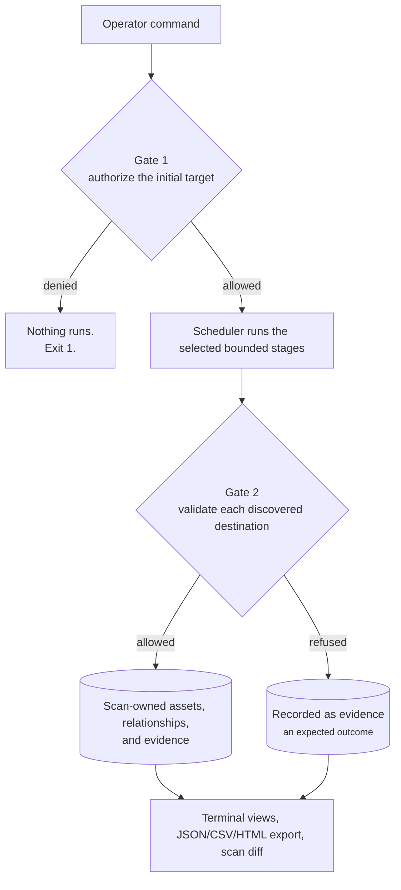

# Sh4q Current State and Maintainer Guide

This is the primary orientation document for Sh4q maintainers. It describes
the current product, what is released, how its parts fit together, and the
checks required before work moves forward. Historical, academic, and design
documents provide context but do not override this guide.

## Current Release

- Published release: `v1.4.0`
- Package version on `main`: `1.4.0`
- Runtime: Python 3.11 or newer on Linux
- Deployment model: local, single-user CLI backed by SQLite
- Distribution: GitHub release and tag; wheel and source artifacts built and
  verified locally; tagged `pipx` installation supported
- GitHub Actions: the `Offline tests` and `Release` workflows are disabled,
  and the account billing lock that caused it is still unresolved. Both
  workflows failed in under four seconds on 2026-09-27, which is what a
  billing refusal looks like, and they were switched off.

  Dependabot's runs do keep succeeding, most recently 2026-10-07, and that is
  not evidence the lock has lifted: Dependabot update jobs execute on GitHub's
  own infrastructure and are not billed against the account's Actions minutes.
  A note here previously cited those runs as proof the billing explanation no
  longer held. It was wrong, and the mistake is recorded rather than quietly
  removed because the same reasoning is easy to repeat -- a green row in the
  Actions tab is not necessarily a job the account paid for.

  **Do not describe remote CI as running.** The offline suite has never passed
  on GitHub, and every release so far was published by hand after local
  verification. Re-enabling the workflow is not a pending experiment; it is
  blocked until the billing issue is resolved

Sh4q is a policy-controlled reconnaissance and evidence tool. It is not a
vulnerability scanner, exploitation framework, broad port scanner, or a
guaranteed-complete attack-surface platform.

## The Mental Model



Gate 1 and Gate 2 are the core invariants. New features must not bypass them.
External tools produce untrusted observations; Sh4q validates their output
before it becomes trusted inventory.

## Scan Modes

The default scan runs:

```text
dns -> http -> certificate transparency
```

Profiles are convenience bundles:

| Mode | Additional stages |
| --- | --- |
| `--profile web` | JavaScript extraction and bounded bundle inspection |
| `--profile full` | Subfinder, HTTPX, URL history, JavaScript extraction, and bundles |

The following remain explicit because they are experimental, active, or can
create materially more traffic:

| Option | Purpose | Boundary |
| --- | --- | --- |
| `--katana` | Runtime URL and XHR discovery | Active crawler, same-scope and bounded |
| `--vhosts` | Virtual-host probing | Active-low, maximum 500 candidates |
| `--directories` | Directory/path probing | Active-low, supplied file and request budget |

Virtual-host candidates can come from `--vhosts-file`,
`--vhosts-from-scan`, or discoveries made earlier in the same scan. Directory
discovery always requires `--directories-file`.

## Configuration and Scope

New YAML configuration files declare:

```yaml
schema_version: 1
```

The file defines scope, exclusions, ports, private-address policy, rate limits,
timeouts, output location, logging, and adapter bounds. Unversioned files are
accepted as legacy version 1. Unsupported or malformed versions fail before
network activity.

Without `--config`, Sh4q derives a narrow scope from the target and permits its
subdomains on ports 80 and 443. Private and reserved addresses are denied by
default.

## Stored Record

Each scan records:

- scan identity, target, timestamps, and status;
- accepted domains, addresses, URLs, technologies, and relationships;
- source-plugin ownership for exact per-scan views;
- raw evidence, rejected observations, failures, retries, and provider status;
- native request metrics and ordered stage metrics.

The global graph deduplicates assets. Evidence remains observation-oriented,
so asset counts and evidence counts intentionally mean different things.

The default database is `./sh4q-output/sh4q.db`. Treat it and generated reports
as potentially sensitive engagement data.

## Operator Workflow

Check the installation and optional tools:

```bash
sh4q --version
sh4q doctor
```

Run the smallest authorized scan that answers the operator's question:

```bash
sh4q scan target.example
```

Inspect the exact result:

```bash
sh4q scans
sh4q show --latest --target target.example
sh4q results --latest --target target.example --type domain
sh4q results --latest --target target.example --type url
sh4q results --latest --target target.example --failures
```

Export or compare scan-owned records:

```bash
sh4q export --latest --target target.example --format html --output report.html
sh4q diff --before BEFORE_SCAN_ID --after AFTER_SCAN_ID
```

## Feature Status

Stable current capabilities:

- scope validation and scoped native networking;
- DNS, HTTP, CT, discovered-DNS, and discovered-HTTP stages;
- durable events, evidence, scan ownership, metrics, and SQLite migrations;
- Subfinder, Waybackurls, HTTPX, JavaScript extraction, and bundle inspection;
- terminal results, scan overview, JSON/CSV/HTML export, redaction, and diff;
- quiet, verbose, and JSONL progress modes;
- versioned configuration schema and named scan templates;
- every authorized port probed, not only the well-known pair;
- resolution and probing of discovered names (`--resolve`) and of an
  operator-supplied host list (`--hosts-file`);
- hostname composition and response-attribute reporting (`results --names`,
  `results --response-attributes`);
- every listing states how much of the matching set it is showing, and `--limit`
  is honoured as given rather than silently clamped;
- a stage cut off at its deadline keeps its completed work rather than
  discarding it, across every stage where partial work can exist;
- the authorisation perimeter refuses strings that cannot name a host, so a
  malformed name is not granted subdomain inheritance;
- `scope.ports` gates inventory as well as contact: a URL on an unauthorised
  port is recorded as refused and does not become an asset.
- a third-party disclosure ledger (`results --disclosures`) and a detection
  surface (`results --detections`, `export --format sigma`). Both read durable
  evidence rather than adding instrumentation, so they work on scans already on
  disk. Detection thresholds are measured from each stage's own recorded
  duration, no rule is written for a stage the target cannot see, and a stage
  that left no duration behind reports an unknown rate rather than a zero.
  Exported rules are validated against pySigma's parser and its validators,
  including the MITRE ATT&CK taxonomy when pySigma's cached bundle is available;
  an optional backend test converts them to a Splunk query.

Implemented explicit capabilities, never enabled by a profile:

- Katana crawling;
- virtual-host discovery;
- directory discovery.

Retired:

- the Amass adapter, removed after `v1.2.0`. Amass stopped printing discovered
  names to standard output at v4, so the adapter observed nothing and reported
  an empty stage. `--sub` covers passive subdomain discovery.

Not implemented yet:

- built-in scheduling;
- proxy configuration;
- comparison metadata for effective configuration and tool versions;
- public API, dashboard, worker queue, PostgreSQL deployment, authentication,
  or RBAC.

## Development Order

The current workflow-foundations milestone proceeds in this order:

1. Versioned configuration files: complete.
2. Named scan templates with explicit stage/risk disclosure: implemented and
   merged, with validation covering stage lists, both candidate-file fields,
   stage/file pairing, and conflicts against every template-owned CLI option.
   Per-stage disclosure of risk level, required tool, and effective limit
   remains follow-up work.
3. Persist effective template/configuration and tool-version identity for
   repeatable comparisons.
4. Proxy support with explicit per-transport and per-adapter behavior. Note
   two constraints found while specifying it: an explicit `transport=` means
   httpx ignores `proxy=`, and IP pinning needs local DNS while proxying for
   privacy needs remote DNS.
5. Scheduling guidance or integration built on stable templates.
6. Platform v2 design only after the local workflow is stable.

Do not add another discovery adapter merely because one is available. Add one
only when it solves a defined operator workflow and retains scope, evidence,
provenance, bounds, and offline coverage.

### Near-term order, verified against source on 2026-10-19

The milestone list above is the roadmap's order. This is the working order,
with each count re-derived from the source rather than carried forward:

1. **Inventory history** — the last unshipped v1 roadmap item (step 6).
   Cheaper than it looks: `first_seen` / `last_seen` already exist on `nodes`,
   are correctly maintained (`first_seen` preserved on conflict, `last_seen`
   updated), and **nothing reads them** — zero references in `application/` or
   `cli/`. This is a view, not a schema migration, and it works retroactively
   on every scan already on disk.
2. **Delete `LoggingConfig`** — parsed, wired into `Sh4qConfig`, never
   consumed; `import logging` appears nowhere in the package. The config
   surface currently advertises a knob that does nothing.
3. **Storage hardening** — 30 unguarded `json.loads` (11 in
   `application/results.py`, 5 in `exporter.py`, the rest spread), and **zero**
   `sqlite3` error handlers anywhere. There is no `StorageError` to wrap them
   in: sh4q defines eight exception classes and none of them is for storage.
   Deliberately not first — every one of those `json.loads` reads a row sh4q
   itself wrote, so this is real debt, not a live hazard.
4. **Template stage disclosure + dry-run** — one job, not two. Both answer
   "what will this run do before it does it" (backlog 0.2 and 4.2).
5. **Execution identity** — roadmap step 3, and a genuine schema migration.
6. **v1.5.0.**
7. **Read seam** — 59 raw `.execute()` calls across 12 modules outside
   `storage/` (15 in `events/event_log.py`, 14 in `application/results.py`, 10
   in `exporter.py`). `StorageRepository` covers only write methods. Worth
   doing on its own merits, not as PostgreSQL preparation: there is no single
   place enforcing that `limit=None` means every row, which *is* the reporting
   invariant; no single place to add the storage wrapping from item 3; nothing
   testable against a fake; and a schema change ripples into 12 files. → v1.6.0.

On Platform v2: `architecture_overview.md` words PostgreSQL as being for
"larger or shared deployments", and only *shared* holds. Data volume is not a
driver — the largest database here holds 8,658 evidence rows, which SQLite does
not notice. The four things that genuinely break are concurrent writers, a file
not being network-reachable, per-operator access control (both gates authorise
*destinations*, nothing authorises operators), and auditing reads. All four
require a second operator to exist, so this is a product decision rather than a
technical inevitability — and a shared deployment rewrites `threat_model.md`,
which assumes `0o700`/`0o600` files on the operator's own machine. That is the
larger change, not the database swap.

`BACKLOG.md` is **stale** — it was written against `v1.3.0` at `964cdc3` and
still reports an 85-test suite. Its item *specifications* are still good; its
status table and counts are not. Trust this section over it.

## Post-Merge Acceptance Checklist

Run these commands from the repository root with the development environment
active:

```bash
git switch main
git pull --ff-only origin main
python -m pip install -e .
sh4q --version
sh4q --help
sh4q scan --help
PYTHONPATH=. python tests/test_documentation_qa.py
PYTHONPATH=. python tests/test_config_schema_version.py
python tools/run_offline_tests.py
git status --short
```

Acceptance means:

- the package version and release documentation agree;
- CLI help opens without a traceback;
- focused tests for the changed behavior pass;
- the full offline runner passes on a supported, known-good environment;
- network-dependent checks are clearly identified and run only by the operator
  against an authorized target;
- no database, report, recording, candidate list, credential, or target evidence
  is staged;
- the PR states motivation, implementation, exact tests, and any unverified
  environment-dependent behavior.

The `v1.4.0` release was validated locally on Python 3.14.4: 99/99 offline
tests, documentation and configuration-schema checks, a fresh-wheel
installation, and end-to-end scans against three targets -- a local lab
exercising the virtual-host, directory, JavaScript and template paths, the
Acunetix test suite, and an authorised university estate running
`--profile full` across 1779 discovered hostnames. That last run is the
acceptance evidence for this release: the resolution accounting balances
exactly (194 resolved plus 1306 failed equals the 1500-name bound), which is
the defect the release fixes. 1 opt-in integration test and 6 network tests run
separately under `--network`; every file in `tests/` is claimed by exactly one
of those lists. An earlier note here
warned that Python 3.14 reproduced timeouts in the async event and SQLite
tests; that has not recurred in repeated runs during this cycle. Report a
full-suite pass only when the runner actually completes.

## Documentation Authority

Use documents in this order when claims conflict:

1. Current code and focused executable tests.
2. This current-state guide.
3. Operator, installation, architecture, threat-model, and limitations docs.
4. The roadmap.
5. Design records under `docs/design/`.
6. Historical and academic material.

Git history replaces session handoff transcripts. New handoff files should not
be committed as permanent product documentation.
